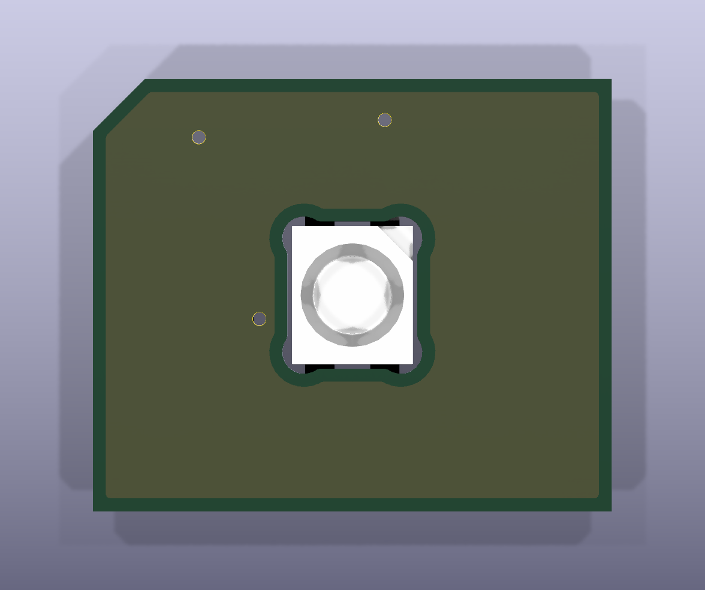
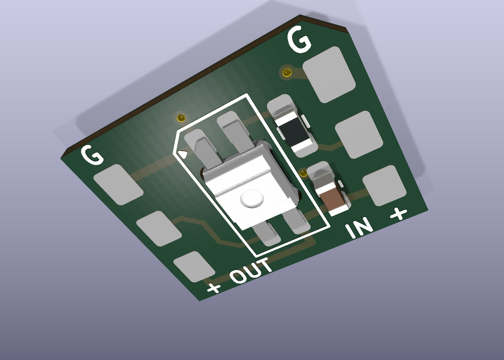
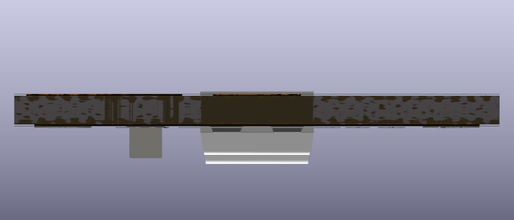

# LED tile, rev A

One reverse-mount SK6812 MINI-E on a 12 × 10 mm board, used to backlight one panel
label. The clock hub uses 12 of them and the synth about 43. Tiles are chained by three
hand-soldered wires each (+5 V, data, GND), from each tile's OUT pads to the next
tile's IN pads.

| Front (faces the panel) | Back (parts and wire pads) |
|---|---|
|  |  |

Schematic: [images/schematic.svg](images/schematic.svg)

## What's on it

| Ref | Part | Why |
|---|---|---|
| D1 | SK6812MINI-E (OPSCO), KiCad footprint `LED_SK6812MINI-E_3.2x2.8mm_P1.5mm_ReverseMount` | The light. Reverse-mount: it sits on the back and shines through a hole in the board. |
| C1 | 100 nF, 0603, X7R, 16 V or more | Local supply for D1's driver chip. The datasheet calls the capacitor "essential". |
| R1 | 330 Ω, 0603 | In series with DIN. The datasheet asks for series resistors on the data pins, against static and surges. That matters here because every tile is hand-wired. |
| J1 | `Synth:WirePads_1x03_P2.80mm` | IN wire pads: GND, data, +5 V. Not a part; left out of the BOM. |
| J2 | same | OUT wire pads: GND, data, +5 V. |

## Board

- **Size:** 12 × 10 mm, 2 layers, **0.8 mm thick** (see the stack-height question below).
- **Orientation key:** one corner is cut at 45°, on the IN/GND corner. A matching pocket in the locating layer means a tile can only go in one way round, so IN and OUT can't be swapped.
- **Back:** every part and every pad. Tracks are 0.25 mm for data and 0.4 mm for power.
- **Front:** a solid ground plane under solder mask, no parts and no silkscreen. It lies flat against the spacer, and nothing printed on it can show through the lit label.
- **Ground:** reaches the plane through three vias, which are covered with mask on both sides.
- **Rules:** copper stays 0.3 mm from every board edge. The one exception is D1's pads to D1's own light hole, which sit at 0.25 mm in KiCad's footprint. `led-tile.kicad_dru` holds that exception. Check it against the chosen maker's limit before ordering.

## Things worth knowing

- **Pin numbers don't match the datasheet.** KiCad's symbol numbers D1 as 1 GND, 2 DIN, 3 VDD, 4 DOUT. The OPSCO datasheet (rev 02) calls the same pins 1 VDD, 2 DOUT, 3 GND, 4 DIN. KiCad's symbol and footprint agree with each other and with the real part: the footprint was checked pad by pad against the datasheet drawing, seen from the back. Go by the pin names. If the board maker's placement preview shows D1 turned, check it by the package's cut corner, which is the GND corner, not by "pin 1".
- **Seen from the back, IN is on the right.** The back silkscreen is printed to read correctly from the back.
- **Data level.** DIN needs at least 0.7 × VDD, which is 3.5 V at 5 V. The first tile must be fed from the main board's 5 V buffer, never straight from the Teensy's 3.3 V pin. Each tile's DOUT then drives the next tile at 5 V.
- **Current.** Each LED draws up to 12 mA per colour, 36 mA at full white, so 12 tiles can draw 0.43 A. Brightness is capped in firmware.
- **Moisture.** The LED is moisture-sensitive (MSL 5a: 24 hours out of its bag), and its peak reflow temperature is 240 °C. That matters only if the LEDs are ever hand-soldered from a bag kept at home.

## Open question: stack height

The tile is about 1.9–2.0 mm deep, from its front face to the back of the LED. The back
of D1 sticks out about 1 mm behind the 0.8 mm board, and C1 about 0.8 mm. The hub
spec's locating layer is about 1.6 mm, so the tile doesn't fit as specced. Options:

1. **A 2.0 mm or thicker locating layer.** The panel stack grows by 0.4 mm or more, so the 17 mm shaft rule grows too.
2. **Clearance holes in the steel sub-panel** under each tile's LED and C1. The steel is laser-cut anyway, so the holes cost nothing, and the stack height stays the same. The PET insulator still covers them.
3. **A thinner board** (0.6 mm). This saves only 0.2 mm, and the datasheet warns about bending stress on boards under 0.5 mm.

To settle at the feel-and-fit mock-up (hub test H2).

## Still to do before ordering

- [ ] Settle the stack-height question above.
- [ ] Panelise: a sheet of 12 tiles with snap-apart tabs and the maker's rails and fiducials (a KiCad plugin such as KiKit does this). Keep the LED's pads at right angles to the snap lines, so snapping doesn't bend the joints.
- [ ] Pick the maker. Confirm that it assembles the LED on the back, in its reversed position, and accepts the 0.25 mm pad-to-hole gap. Choose white solder mask if offered, so light reflects up into the pocket.
- [ ] Choose exact R1 and C1 part numbers from the maker's stock.
- [ ] Print the board 1:1 on paper and lay a real LED on the footprint (hub test H4).
- [ ] Independent review of the schematic and board (hub test R4).
